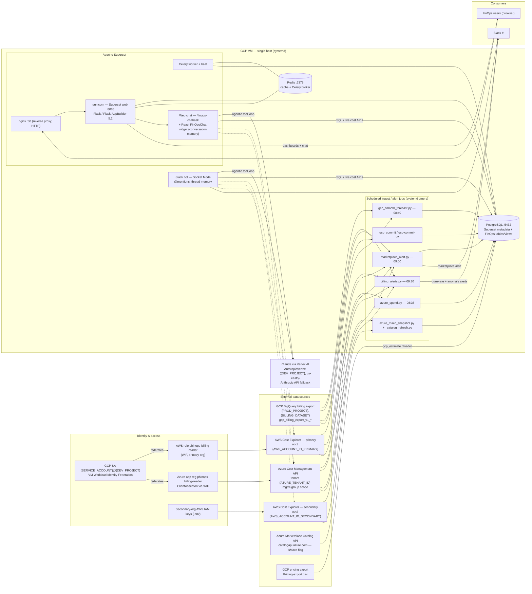
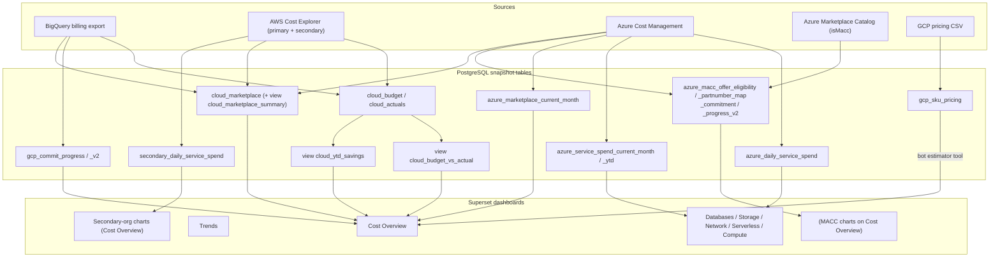

<!--
Licensed to the Apache Software Foundation (ASF) under one
or more contributor license agreements.  See the NOTICE file
distributed with this work for additional information
regarding copyright ownership.  The ASF licenses this file
to you under the Apache License, Version 2.0 (the
"License"); you may not use this file except in compliance
with the License.  You may obtain a copy of the License at

  http://www.apache.org/licenses/LICENSE-2.0
-->

# phinops — System Architecture

**phinops** is a FinOps platform built on Apache Superset. It ingests
multi-cloud billing data (GCP, AWS ×2 orgs, Azure), stores derived snapshots in
PostgreSQL, visualizes them in Superset dashboards, and exposes two Claude-powered
assistants (a Slack bot and an in-app web chat) plus daily cost-anomaly / budget /
marketplace alerts to Slack.

> Deployment today is a **single GCP VM** (`<VM_IP>`). Migration to GKE in the
> `<AGENTS_PROJECT>` project is tracked in issue #2.

---

## 1. High-level architecture

---

## 2. Data-flow / lineage (source → table → chart)

---

## 3. Scheduled jobs (systemd timers)

| Job (script) | Schedule | Writes / does |
|---|---|---|
| `azure_spend.py` | daily 08:35 | `azure_*` snapshot tables (subscription/service MTD, daily, service-YTD, marketplace YTD incl. GitHub rows) |
| `gcp_smooth_forecast.py` | daily 08:40 | `cloud_actuals.forecast_override` (smooth forecast) + **finalizes prior month** on rollover |
| `marketplace_alert.py` | daily 09:00 | Refreshes `cloud_marketplace` (GCP + AWS primary/secondary + Azure); posts marketplace alert to Slack; re-fires on late charges |
| `billing_alerts.py` | daily 09:30 | Burn-rate (GCP, AWS primary/secondary, Azure) + 7 GCP anomaly analysts + AWS/Azure anomaly checks → Slack |
| `azure_macc_catalog_refresh.py` | weekly | `azure_macc_offer_eligibility` (Catalog `isMacc`) |
| `azure_macc_snapshot.py` | daily | `azure_macc_progress_v2` (eligibility-proxy drawdown) |
| `gcp-commit-v2` | daily | `gcp_commit_progress_v2` (commit drawdown) |
| `marketplace_backfill.py` | one-shot | Idempotent historical backfill of `cloud_marketplace`, all providers |

---

## 4. Identity & access

| Path | Mechanism |
|---|---|
| VM → GCP | Attached service account `<SERVICE_ACCOUNT>@<DEV_PROJECT>.iam.gserviceaccount.com` |
| → AWS (primary, `<AWS_ACCOUNT_ID_PRIMARY>`) | GCP **Workload Identity Federation** → assume role `phinops-billing-reader` (auto-refreshing) |
| → AWS (secondary, `<AWS_ACCOUNT_ID_SECONDARY>`) | Long-lived IAM user keys in `.env` (`SECONDARY_AWS_*`) |
| → Azure (tenant `<AZURE_TENANT_ID>`) | App reg `phinops-billing-reader` (`<AZURE_APP_ID>`), `ClientAssertionCredential` federated from the GCP SA; **Cost Management Reader** at mgmt-group scope |
| → Azure Marketplace Catalog | Anonymous (`catalogapi.azure.com`) |
| Superset login | `AUTH_DB` (admin) — SSO (OAuth/IAP) not yet enabled |
| Bots → Superset | Authenticate as `admin` over `localhost` (`SUPERSET_ADMIN_PASSWORD`) |
| Bots → LLM | Vertex AI (`AnthropicVertex`, project `<DEV_PROJECT>`) or Anthropic API key |

---

## 5. Assistant tool surface (both bots)

`scripts/slack_bot.py` (Socket Mode, thread-scoped memory) and
`superset/views/finops_chat.py` (`/finops-chat/ask`, conversation memory) share an
agentic Claude tool loop:

- **GCP** — `get_gcp_monthly_spend`, `_spend_by_service`, `_spend_by_project`, `_cost_trend`, `run_superset_sql` (BigQuery)
- **AWS** — `get_aws_monthly_spend`, `_spend_by_service`, `_spend_by_account`, `_cost_trend` (primary + secondary)
- **Azure** — `get_azure_monthly_spend`, `_spend_by_service`, `_spend_by_subscription`, `_cost_trend`, **`query_azure_cost`** (flexible deep-query: any dimension/filter, multi-year auto-chunked — the Azure analog of `run_superset_sql`)
- **Pricing** — `lookup_gcp_sku_pricing`, `estimate_gcp_project_cost` (contract pricing from `gcp_sku_pricing`)
- **Charts** — `create_superset_chart`, `read_superset_chart` (web bot)

---

## 6. Key dashboards

`Cost Overview` (flagship: budget-vs-actual, YTD savings, MACC drawdown, marketplace by
product, GitHub, secondary org), `Trends`, `Databases`, `Memorystore`, `Data Analytics`,
`Compute Engine` / `Compute Engine - flexCUD` / `Compute Services`, `Kubernetes`,
`Storage Cost`, `Network Cost`, `Serverless Computing Cost`, `Marketplace Services`,
`Cost Reporting: Credits/Labels/Regions`.

---

## 7. Known gaps / roadmap

- **#1** Citations — bots should cite the source/params behind each answer.
- **#2** Production deployment — migrate to GKE (`<AGENTS_PROJECT>` / `ai-agents`): containers, Cloud SQL, Memorystore, Workload Identity, Secret Manager, ingress + TLS + SSO.
- **#3** Datadog integration — tag-enriched cloud-cost / unit-cost data.
- **#4** Recommended improvements — pipeline failure alerting, chart-config hygiene/lint, tests/CI, secrets out of `.env`, shared bot tool layer.

> **Single-VM caveats:** SPOF, plain-HTTP bare-IP ingress, `admin/admin` auth, secrets in
> `.env`, and silent job failures — all addressed by #2 / #4.
